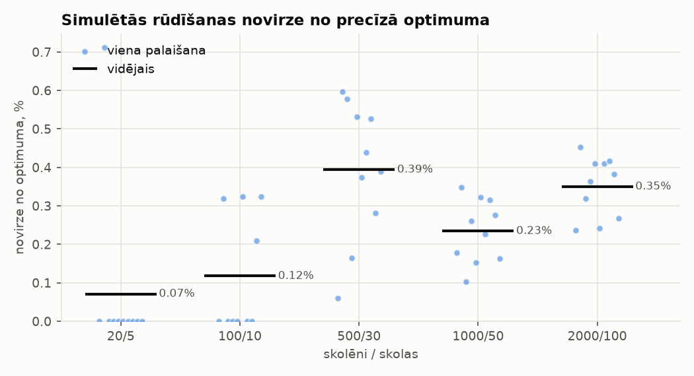
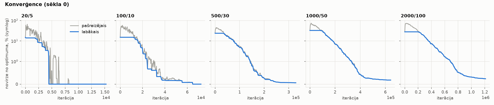
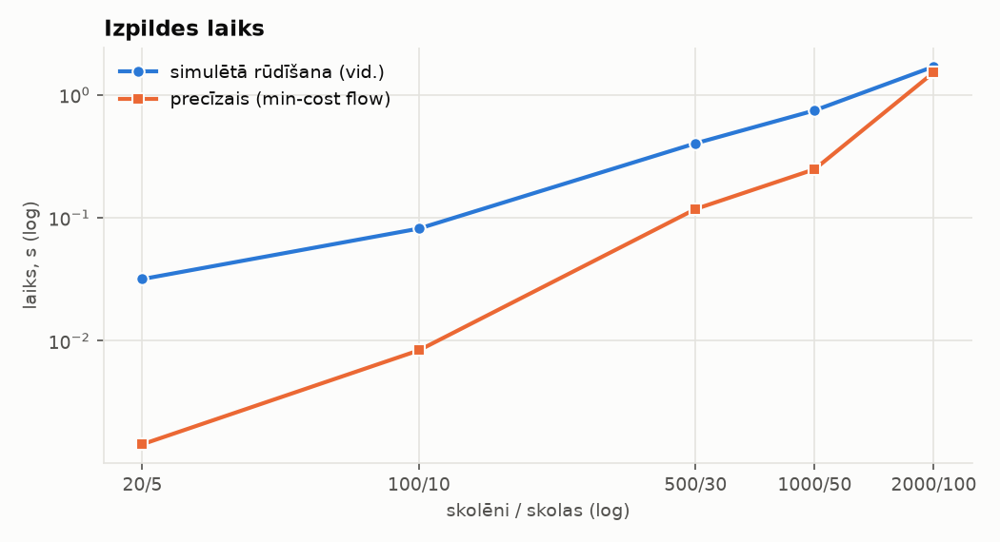
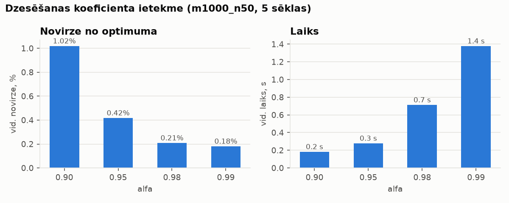

# Skolēnu piekārtošana skolām ar simulēto rūdīšanu

Kursa darbs: optimizācijas algoritma implementācija Python valodā.
Simulētā rūdīšana ir realizēta pašu spēkiem; izmantotas tikai `numpy` un
`matplotlib` (nekādu gatavu optimizācijas bibliotēku).

## Uzdevums

Doti `n` skolas un `m` skolēni. Skolai `j` ir ietilpība `s[j]`, un
`s[1] + ... + s[n] >= m`. Zināmi attālumi `a[k, j]` no skolēna `k` līdz
skolai `j`. Katram skolēnam jāpiešķir tieši viena skola tā, lai kopējais
attālums būtu minimāls un neviena skola nebūtu pārpildīta:

```
min  Σ_k a[k, x[k]]
kur  x[k] ∈ {1..n}  katram skolēnam k,
     |{k : x[k] = j}| <= s[j]  katrai skolai j.
```

## Risinājuma metode

| Sastāvdaļa | Realizācija (`src/sa.py`) |
|---|---|
| Domēns | `assign[k]` — skolēna `k` skola; `load[j]` — skolu aizpildījuma skaitītāji; papildus katras skolas skolēnu saraksts nejaušas izvēles vajadzībām |
| Novērtēšana | attālumu summa (`total_cost`); `validate` noraida pārpildītus risinājumus — algoritms tos nekad neapskata |
| Sākuma risinājums | alkatīgi: katram skolēnam tuvākā skola, kurā vēl ir brīva vieta (`greedy_initial`) |
| Gājieni | **pārcelšana**: skolēnu `k` uz skolu `j` ar brīvu vietu, `Δ = a[k,j] − a[k,x[k]]`;<br>**apmaiņa**: skolēni `k1`, `k2` no dažādām skolām apmainās vietām, `Δ = a[k1,x2] + a[k2,x1] − a[k1,x1] − a[k2,x2]`.<br>Abiem Δ rēķina inkrementāli O(1) laikā. Mērķa skolu izvēlas starp 5 skolēnam tuvākajām skolām (kandidātu saraksts); apmaiņas partneri — nejaušu šīs skolas skolēnu |
| Dzesēšana | `T ← α·T` pēc katriem `2m` gājieniem, līdz `T < 0.2`; pasliktinājums tiek pieņemts ar varbūtību `exp(−Δ/T)`; `T0` izvēlas tā, lai vidējais pasliktinājums sākumā tiktu pieņemts ar varbūtību 0.3 |

Noklusējuma parametri: `α = 0.98`, `t_end = 0.2`, apmaiņas varbūtība
`p_swap = 0.7`, kandidātu saraksts `n_near = 5`. Tie izvēlēti ar nelielu
pārlasi uz 3 sēklām: apmaiņas gājieni un šaurāks kandidātu saraksts deva
mazāku novirzi nekā `p_swap = 0.5, n_near = 10` pie līdzīga laika, bet
`α = 0.98` ir labs kompromiss starp kvalitāti un laiku (sk. `alpha.png`).

### Etalons (`src/exact.py`)

- **Precīzs algoritms** — minimālo izmaksu plūsma ar secīgiem īsākajiem
  ceļiem. Skolēnus pievieno pa vienam; īsāko papildinošo ceļu meklē grafā,
  kura virsotnes ir skolas, bet šķautne `i → j` nozīmē „pārcelt kādu skolas
  `i` skolēnu uz `j`” ar svaru `min_k (a[k,j] − a[k,i])`. Svari var būt
  negatīvi, tāpēc izmantots vektorizēts Belmana–Forda algoritms. Pēc katra
  papildinājuma pārrēķina tikai mainīto skolu šķautnes.
- **Apakšējā robeža** — katrs skolēns tuvākajā skolā, ignorējot ietilpības.
- **Pilnā pārlase** — visi `n^m` piešķīrumi; izmanto tikai testos, lai
  pārbaudītu precīzo algoritmu ļoti mazos piemēros.

Uzdevumā bija paredzēts precīzo algoritmu lietot mazākiem piemēriem, bet
lielākiem — apakšējo robežu. Tā kā realizētais min-cost flow arī 2000/100
piemēru atrisina ~1,5 s laikā, etalons visiem piemēriem ir **precīzs
optimums**. Apakšējā robeža ir rādīta salīdzinājumam; ar karodziņu
`--exact-max-m` var likt lielākiem piemēriem izmantot to.

## Struktūra

```
src/generator.py   piemēru ģenerators, saglabāšana un ielāde
src/sa.py          novērtēšana, sākuma risinājums, gājieni, simulētā rūdīšana
src/exact.py       precīzais algoritms, apakšējā robeža, pilnā pārlase
src/run_tests.py   eksperimenti; raksta results/
src/plots.py       grafiki
tests/             vienībtesti (pytest)
instances/         5 saglabātie testu piemēri (.npz)
results/           results.csv, runs.csv, alpha_sweep.csv, log.txt, *.png
```

Piemēri: skolēni un skolas nejauši izvietoti kvadrātā 1000×1000, attālumi
ir noapaļoti Eiklīda attālumi (veseli skaitļi), ietilpības nevienādas, to
summa ir `⌈1.1·m⌉`.

## Uzstādīšana

Nepieciešams Python 3.9+.

```bash
python -m venv .venv
source .venv/bin/activate        # Windows: .venv\Scripts\activate
pip install -r requirements.txt
```

## Palaišana

Visas komandas izpilda no repozitorija saknes.

```bash
python -m pytest                       # vienībtesti (~10 s)
python -m src.run_tests                # pilns eksperiments (~1 min)
python -m src.run_tests --runs 3 --no-alpha --no-plots   # ātrs variants
python -m src.generator                # izveido trūkstošos piemērus instances/
```

Algoritmu var izmantot arī tieši:

```python
from src.generator import generate
from src.sa import simulated_annealing
from src.exact import min_cost_assignment

inst = generate(500, 30, seed=1)
res = simulated_annealing(inst.dist, inst.cap, seed=0)
print(res.cost, min_cost_assignment(inst.dist, inst.cap)[1])
```

## Testēšana

`tests/` pārbauda: mērķa funkciju un derīguma pārbaudi; ģeneratoru un
alkatīgo risinājumu; ka inkrementālais Δ sakrīt ar pilnu pārrēķinu tūkstošiem
nejaušu gājienu un stāvoklis paliek konsekvents; rūdīšanas atkārtojamību un
dzesēšanas grafiku; ka precīzais algoritms sakrīt ar pilno pārlasi 40 ļoti
mazos piemēros (m ≤ 7, n ≤ 3) un ka `apakšējā robeža ≤ optimums ≤ SA`.

## Rezultāti

10 palaišanas katram piemēram (sēklas 0–9). Novirze — % no precīzā optimuma.
Laiki mērīti vienā CPU kodolā mākoņa konteinerī; citā datorā tie atšķirsies.

| Skolēni/skolas | Optimums | SA labākais | SA vidējais ± σ | Labākā novirze | Vidējā novirze | Trāpījumi optimumā | Alkatīgais | SA laiks, s | Precīzais, s |
|---|---:|---:|---:|---:|---:|---:|---:|---:|---:|
| 20/5 | 6 456 | 6 456 | 6 460,6 ± 14,5 | 0,00 % | 0,07 % | 9/10 | +14,9 % | 0,03 | 0,001 |
| 100/10 | 22 528 | 22 528 | 22 554,5 ± 35,0 | 0,00 % | 0,12 % | 6/10 | +15,1 % | 0,08 | 0,008 |
| 500/30 | 83 285 | 83 335 | 83 613,2 ± 149,9 | 0,06 % | 0,39 % | 0/10 | +24,0 % | 0,40 | 0,12 |
| 1000/50 | 97 194 | 97 294 | 97 422,0 ± 80,8 | 0,10 % | 0,23 % | 0/10 | +32,6 % | 0,75 | 0,25 |
| 2000/100 | 129 048 | 129 353 | 129 499,8 ± 101,7 | 0,24 % | 0,35 % | 0/10 | +27,8 % | 1,70 | 1,52 |

Apakšējā robeža (bez ietilpībām) ir par 18–67 % zemāka nekā optimums, tāpēc
novirze no tās (18,6 %, 31,9 %, 67,3 %, 34,0 %, 26,1 % SA vidējam) daudz
vairāk raksturo robežas vājumu nekā algoritma kvalitāti. Tas ir iemesls,
kāpēc etalonam izmantots precīzais algoritms.

Dzesēšanas koeficienta ietekme (1000/50, 5 sēklas):

| α | 0,90 | 0,95 | 0,98 | 0,99 |
|---|---:|---:|---:|---:|
| Vidējā novirze | 1,02 % | 0,42 % | 0,21 % | 0,18 % |
| Vidējais laiks, s | 0,18 | 0,28 | 0,71 | 1,38 |






### Secinājumi

- Simulētā rūdīšana uzlabo alkatīgo sākuma risinājumu vidēji par 13–24 %;
  vidējā novirze no optimuma visos piemēros ir zem 0,4 % (sliktākā
  palaišana: 0,71 %), un mazos piemēros tā bieži atrod precīzu optimumu.
- Inkrementāls Δ ļauj izmēģināt ~1,2 milj. gājienu 2000/100 piemērā
  ~1,7 s laikā tīrā Python.
- Šim uzdevumam eksistē polinomiāls precīzs algoritms (tas ir transporta
  uzdevums), un mūsu piemēros tas ir ātrāks par SA vai līdzvērtīgs tai.
  SA priekšrocība būtu modeļa paplašinājumos, kuri izjauc plūsmas
  struktūru (piemēram, nelineāras izmaksas vai papildu ierobežojumi
  skolēnu grupām), jo gājienus un Δ var viegli pielāgot.
